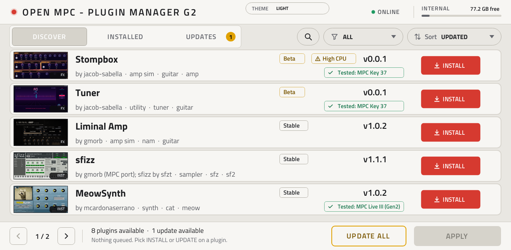

# Open MPC: a plugin toolchain for MPC OS

Build, skin, release and distribute native plugins for **Akai MPC OS standalone devices** (MPC Live/One/X/Key, Force).
Plugins run inside MPC's built-in JUCE plugin host, so they behave like MPC's own instruments and effects: you add them to a
track, play them from pads, keys or the sequencer, turn them with Q-Links, and they save with the project. Each one gets its
own **native MPC touchscreen page**. No bridge, no background app, no `LD_PRELOAD` for plugins.

> 💬 **Community:** join [**Open MPC** on Discord](https://discord.gg/sRRysZSgu3) for support, release announcements, plugin requests and MPC hacking.

[**Plugin catalog**](https://open-mpc.github.io/) · [**Installer app**](https://github.com/open-mpc/mpc-vst-plugins/releases/tag/desktop-v1.1.2) · [**Plugin Manager VST**](tools/plugin_manager_g2/README.md) · [Build guide](https://open-mpc.github.io/build.html) · [Release workflow](https://open-mpc.github.io/workflow.html)

[](https://open-mpc.github.io/)

## What is in the box

| | |
|---|---|
| **Plugins** | Synths, samplers, drum machines, sequencers, effects and app-like plugins, ported from existing C/C++ engines. |
| **Addins** | Libraries MPC preloads at start-up: web remote control, USB audio, rolling recorder and similar. [docs/ADDINS.md](docs/ADDINS.md) |
| **Device patches** | Opt-in changes to the device itself: 16-pad drum layout, button remap, drive exec, auto exec. [tools/mpc_patch](tools/mpc_patch/README.md) |
| **Catalog** | One browsable list of everything above, with versions, SHA-256 checksums and hardware-test status. |
| **Installers** | Desktop app, an on-device Plugin Manager VST, a shell command and USB-stick routes. |
| **Toolchain** | Everything to port, skin, test, benchmark, package and publish your own. |

## What you can build

- **Instruments and effects** that play from pads, keys and MIDI clips, with Q-Links, automation, presets in MPC's PRESET menu
  and settings saved in the project.
- **Ports of existing engines**: describe the parameters in one small `vst.json` and the tools build the plugin, its page and
  its Q-Link map. Engines written for Ableton Move's [Schwung](https://github.com/charlesvestal/schwung) host build unchanged
  through an adapter.
- **MIDI generators**: sequencers and arpeggiators that play other tracks, synced to MPC's tempo.
- **App-like plugins** that use the network (HTTP/HTTPS), read and write files or run helper programs, such as a record-digging streamer.
- **Native pages**: knobs, faders, switches, buttons, option selectors, pop-up lists, live text readouts and your own artwork
  (any font, knob style or Inkscape drawing, baked into the page).
- **Ports for the desktop**: the same port as a VST3 for local use in a DAW, showing its MPC skin. [docs/DESKTOP_VST3.md](docs/DESKTOP_VST3.md)

## The workflow

```
describe  ->  build  ->  skin  ->  test on PC  ->  bench on device  ->  release  ->  list in catalog  ->  users install
```

1. **Describe** the engine in a `vst.json`: name, UID, parameters, sources. [docs/PORTING.md](docs/PORTING.md)
2. **Build** with `tools/build_port.sh vst.json`: the `.so` (armhf, glibc 2.31; aarch64 for Gen2), the skin and the `MPC.settings` entry.
3. **Skin** it automatically, in the browser-based **Skin Studio** (`SkinStudio.command` / `.bat` / `.sh`, needs Python 3), or from a
   layout you design. [docs/SKIN_STUDIO.md](docs/SKIN_STUDIO.md)
4. **Test offline** with `tools/test_port.sh vst.json` (x86 host test under ASan), then **benchmark on the device** with
   `tools/bench.sh`. [docs/BENCH.md](docs/BENCH.md)
5. **Release** with `tools/release.py` or the reusable `vst-release.yml` GitHub Actions workflow, which builds, tests, previews and
   packages a draft release. Test the draft zip on a device, then publish. [docs/RELEASING.md](docs/RELEASING.md)
6. **List it**: open one PR adding `catalog/plugins/<id>.json`. After that the catalog reads your releases every night and checks each zip.
   [Getting listed](https://open-mpc.github.io/workflow.html#list-it-in-the-catalog)
7. **Users install** it from the catalog with the installer app, the Plugin Manager VST or `mpc-store.sh`.

Emulator and firmware ports (big.LITTLE pinning, ring buffers, PGO): [docs/EMULATOR_PORTS.md](docs/EMULATOR_PORTS.md).

## The catalog

**[open-mpc.github.io](https://open-mpc.github.io/)** lists the community's plugins, addins and device patches.

- **Find:** search; filter by kind, style, developer, license, MPC OS support or distribution; sort by recently updated or most downloaded.
  An Atom feed (`feed.xml`) announces new releases.
- **Trust tiers:** **Verified** (newest release tested on real hardware and the test recorded, per generation), **Listed** (passed the
  automatic release checks, no hardware test recorded) and **Experimental** (new or unproven, hidden unless you ask). This is not a
  security review: nobody reads each plugin's code, so stick to developers you trust.
- **Every version** shows its date, SHA-256 and what it was tested on. A failed check hides the version and opens an issue.
- **Collections:** plugins one developer publishes from one repo are one card.
- **Build it yourself:** ports built from your own firmware can never ship a zip, so they list the exact build command instead.
- **Contribute:** [catalog/README.md](catalog/README.md) (how), [docs/CATALOG.md](docs/CATALOG.md) (design),
  [docs/CATALOG_SPEC.md](docs/CATALOG_SPEC.md) (formats). Open-source licenses, or public source with a limited-use license
  (shown as "Restricted use").

## Installing

[](tools/plugin_manager_g2/README.md)

| Route | For |
|---|---|
| **[Installer app](tools/desktop/README.md)** (Windows, Mac, Linux) | Connects over SSH, installs a batch of catalog plugins or your own zips with one MPC restart, backs up settings first, removes plugins, installs to SD/USB, runs device patches. |
| **[Plugin Manager VST](tools/plugin_manager_g2/README.md)** | A plugin that browses the catalog and installs, updates and removes plugins on the MPC itself, with rollback. Gen1 and Gen2. |
| **`tools/mpc-store.sh`** | The same install, update, remove and sync from a shell on the device. |
| **USB stick, no SSH** | [docs/USB_STICK.md](docs/USB_STICK.md) (Gen1/Force), [docs/GEN2.md](docs/GEN2.md) (Gen2). |
| **Release zip** | Each zip carries its own `install.sh`, `uninstall.sh` and `INSTALL.md`. [Install guide](https://open-mpc.github.io/install.html) |

## Addins and device patches

Not everything is a plugin. Two more kinds of community work are in the catalog and use the same tooling:

- **Addins** are libraries MPC loads at start-up (`LD_PRELOAD`), installed to `/data/mpc-addins/` by one shared, collision-safe
  installer and released with `tools/release_addin.py`. Rules and examples: [docs/ADDINS.md](docs/ADDINS.md).
- **Device patches** change the device rather than add files: the 16-pad drum layout, drive exec, auto exec, button remap and addin
  restore. Each is a standalone script with `status` / `install` / `uninstall`, a backup and a typed confirmation, and none ever
  applies by default. Run them by hand or from the installer app's Advanced step; they also have a **Device patches** tab and guide
  pages in the catalog. [tools/mpc_patch/README.md](tools/mpc_patch/README.md), [docs/PATCHES.md](docs/PATCHES.md)

## Compatibility

| | Gen1 (ARM32): Live/Live II, One, X, Key 61, Force | Gen2 (aarch64): Live III, One G2, Key(s) G2 |
|---|---|---|
| Plugin build | armhf against glibc 2.31 | separate aarch64 build per plugin |
| Setup | root SSH, or USB stick | USB script / Plugin Manager VST; root filesystem is read-only |
| MPC OS | 2.x (glibc 2.32) and 3.x (2.39) | 3.x |
| Checked on | Force 3.9.1 (reference), MPC Live 2.15.1 | Live III |

Every release is built on a pinned toolchain, checked against the catalog's rules (layout, checksums, glibc and CPU limits),
smoke-tested on a device and labelled **2.x + 3.x** or **3.x only** from its library and skin. A 3.x-only plugin loads on 2.x and
plays from the Q-Links, but its page stays empty until its developer ships a compatible skin. Details, the 2.x skin shape and
device internals: [docs/COMPATIBILITY.md](docs/COMPATIBILITY.md), [docs/OS2_SKINS.md](docs/OS2_SKINS.md).

## Limits

VST2 only (a desktop VST3 build exists) · no native drop-down picker, custom-drawn widgets or text entry · two fonts for live text
(Titillium Web, Roboto) · plugin MIDI out is ignored by MPC (generators open their own port) · notes land on 128-sample blocks
unless a port opts into sample-accurate starts · a plugin crash takes MPC down · Gen1 gives a plugin about 2.9 ms per audio block, shared
with the whole project. Full list: [docs/COMPATIBILITY.md](docs/COMPATIBILITY.md#limitations). What is next: [docs/ROADMAP.md](docs/ROADMAP.md).

## Documentation

| I want to... | Read |
|---|---|
| Port an engine | [PORTING.md](docs/PORTING.md), [EMULATOR_PORTS.md](docs/EMULATOR_PORTS.md), [MIDI_TIMING.md](docs/MIDI_TIMING.md) |
| Design a page | [SKIN_STUDIO.md](docs/SKIN_STUDIO.md), [SKIN_VARIANTS.md](docs/SKIN_VARIANTS.md), [COMMUNITY_SKINS.md](docs/COMMUNITY_SKINS.md) |
| Measure and ship | [BENCH.md](docs/BENCH.md), [RELEASING.md](docs/RELEASING.md), [CATALOG.md](docs/CATALOG.md) |
| Know what is verified | [NOTES.md](docs/NOTES.md) (hardware facts, dated), [MPC_OS_REFERENCE.md](docs/MPC_OS_REFERENCE.md) |
| Work with Gen2 or MPC OS 2.x | [GEN2.md](docs/GEN2.md), [OS2_SKINS.md](docs/OS2_SKINS.md), [COMPATIBILITY.md](docs/COMPATIBILITY.md) |
| Run an addin or patch | [ADDINS.md](docs/ADDINS.md), [PATCHES.md](docs/PATCHES.md) |

Repository map: [docs/COMPATIBILITY.md](docs/COMPATIBILITY.md#repository-layout).

## Credits

The route was first described on the MPC-Forums thread "Proof of Concept: Custom Standalone Plugins" (Sep 2026) by NoQuestion and
dustyslices. [Schwung](https://github.com/charlesvestal/schwung) by @charlesvestal, the open module platform for Ableton Move,
inspired a good part of how this project is built: the small engine interface our wrapper and the `adapters/schwung` adapter follow,
the build, test and release workflow for modules, and the catalog model. We made our own versions for MPC OS; thank you for building
it in the open. The Plugin Manager VST began as a fork of poloq's MIT-licensed `mpc-vst-manager`.

Credits also to the MockbaMod community for assistance in development, especially @Locrian.

## Legal

The code in this repository is under the MIT licence (see [LICENSE](LICENSE)); vendored third-party files keep their own licences.

VST2 is a deprecated Steinberg format; this project uses a hand-written ABI header and is for personal, non-commercial
experimentation on hardware you own. No Akai content is redistributed. Editing `MPC.settings` is at your own risk; back it up first.
