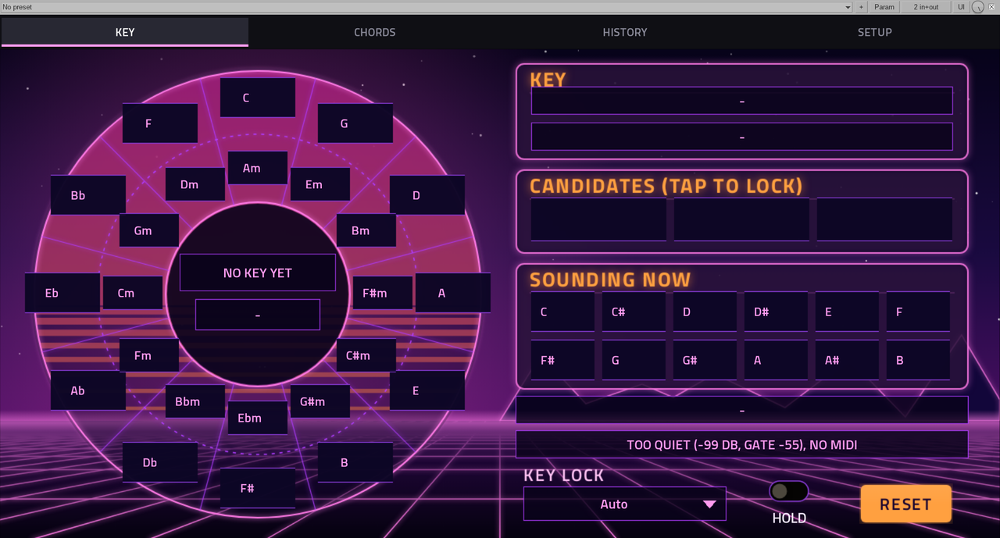
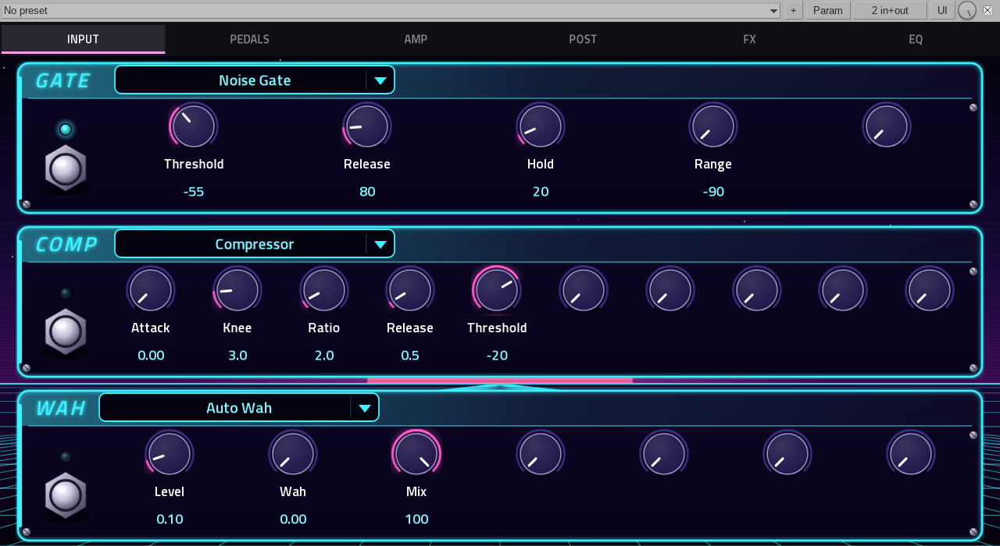
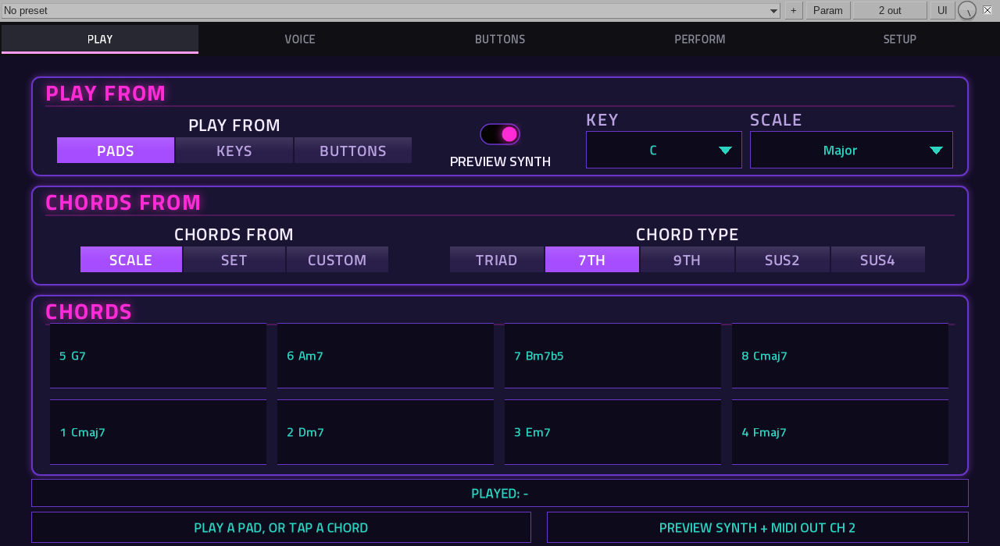

# Desktop VST3 build

Any port built from a `vst.json` with the generic wrapper can also be built as a VST3 plugin for a desktop DAW on Linux,
from the same engine and parameters. This is for local use beside the device build: MPC OS loads only VST2
(docs/NOTES.md, "VST3: not supported by MPC OS"), so `tools/build_port.sh` stays the build that goes to a device, and
nothing here changes it.

```sh
tools/build_vst3.sh <port>/vst.json             # <port>/build/vst3/<name>.vst3
tools/build_vst3.sh <port>/vst.json --install   # and copy it to ~/.vst3
tools/test_vst3.sh <port>/vst.json              # offline test under ASan/UBSan (below)
```

Build the port's skin first with `tools/build_port.sh` (it writes `build/skin/`), or set `VST3_SKIN` to a built skin folder.
The plugin window then shows that skin (below). Without a skin it has no editor, and the DAW shows its generic parameter view.

It uses the host's `gcc`/`g++`, with no Docker, and builds for the machine it runs on (x86_64 or aarch64 Linux). Ports with
their own hand-written wrapper, or no `params`/`build.sources` in `vst.json`, are not covered.

**Status (2026-10-30):** the wrapper and its editor pass their tests offline. Six ports load in Reaper 7.82 on Linux
(Hyprland, Reaper under Xwayland), and their plugin windows show the port's MPC skin with live values.







## Windows (prepared, 2026-10-31, offline under Wine only)

`VST3_TARGET=windows tools/build_vst3.sh <port>/vst.json` cross-builds a 64-bit Windows bundle,
`<name>.vst3/Contents/x86_64-win/<name>.vst3`, with mingw-w64 (`x86_64-w64-mingw32-gcc`). The DLL is static (engine, winpthreads
and the C++ runtime), exports `GetPluginFactory`, `InitDll` and `ExitDll`, and `plugin_dir.h` finds its folder with
`GetModuleFileName`. `VST3_TARGET=windows tools/test_vst3.sh <port>/vst.json` builds the same and runs `vst3_host_test.c`
(built for Windows) under Wine: factory, parameters, audio at three rates, state.

What is not done:

- **Not run on a real Windows host or DAW.** Wine passes the test with `poc/uiprobe`; nobody has loaded a bundle in a
  Windows DAW yet. Copy the bundle to `C:\Program Files\Common Files\VST3`. `--install` is Linux-only.
- **No editor.** `vst3_editor.c` is X11 + cairo + FreeType; a DAW shows its generic parameter view. A Windows editor needs a
  `"HWND"` platform type view and a window/paint layer in place of the X11 one (cairo's win32 surface, or GDI), and cairo and
  FreeType built for mingw (not packaged here). The skin loading and drawing code is platform-neutral and can stay.
- **Engines are POSIX code.** The wrapper builds, but an engine that includes `dlfcn.h`, `unistd.h`, ALSA or similar
  (the Maschine engine does) needs those parts guarded for `_WIN32` first. Self-contained engines such as the probes build as is.
- No installer or catalog entry for Windows binaries.

## How it maps onto VST3

`wrapper/vst3_wrap.c` drives the same `mpc_engine_t` as `vst2_wrap.c`, from the same generated `params.h`. The VST3 ABI is
hand-written in `wrapper/vst3_abi.h`, with struct sizes asserted against the SDK's headers; no Steinberg SDK is in this
repository.

- **One object.** The plugin is a single component: processor and edit controller in one object, so the controller
  reads the engine directly and nothing passes messages between them.
- **Sample rate.** The engine still runs at 44100 Hz. `wrapper/resample.h` (windowed sinc) converts on the way in and out
  at any host rate. Its time mapping is exact, so it adds no delay of its own beyond the filter's look-ahead.
- **Blocks and latency.** Audio goes through the engine in 128-frame blocks. An effect reports a fixed latency, which the DAW
  compensates: 128 frames at 44.1 kHz, 179 at 48 kHz, 355 at 96 kHz. An instrument renders ahead on demand and reports none.
  MIDI goes in before the engine block that holds it, or at its exact frame with `SAMPLE_ACCURATE`.
- **Parameters** keep their VST2 index as their VST3 ID, so the numbering is the same in both builds. These are left out
  or added:
  - Popup flags are left out (screen-only).
  - Option lists are list parameters, and whole numbers are stepped.
  - Text readouts (`"display": "string"`) are read-only parameters whose text is the engine's.
  - Host changes are applied in `process()` at the block start.
  - Values the engine changes by itself go back to the host through `outputParameterChanges`. That covers presets,
    `display_rev`, `mpc_engine_changed`, CC-mapped parameters and momentary releases.
- **Bypass.** A bypass parameter is added. A bypassed effect outputs its input, delayed by the same latency, so switching
  never shifts timing. A bypassed instrument goes silent. The engine keeps running either way.
- **Presets.** `vst.json` `"presets"` become a program-change parameter. `"programs"` ports keep their own preset
  parameter.
- **MIDI.** Notes arrive as events. VST3 hosts send CCs, pitch bend and channel pressure only as parameters, so hidden
  parameters (one per controller per channel, through IMidiMapping) turn them back into MIDI bytes for the engine. The CC
  20-35 and NRPN control of `vst2_wrap.c` works the same. Every controller move becomes a message, a repeated value too,
  so NRPN data entry can set two parameters to the same value in a row.
- **Transport.** `HAS_LFO_BPM`, `HAS_TRANSPORT` and `HAS_SONG_POS` read the host's tempo, play state and song position.
- **State.** The engine's `"state"` text when it has one. Otherwise every setting is saved as `key=value` lines, leaving
  out `"live"` values. Program and bypass come after them.
- **Identity.** The class ID is `MPC3`, then the four-character `uid`, then a hash of vendor and name. It is stable across
  builds, so saved projects find the plugin again.
- **MPC-specific behaviour is left out:** the parameter-0 hold, Q-Link tick counting and settling, button debounce, and the
  UpdateDisplay throttling.
- **`MPC_DESKTOP`.** Every source is compiled with `-DMPC_DESKTOP=1`, so an engine can leave out what only works on a device,
  such as drawing on MPC's screen (the Tuner does this).
- **Engine data.** A port with a `MODULE_SUBDIR` define gets that folder, empty, next to the `.so`
  (`<Name>.vst3/Contents/x86_64-linux/<subdir>`), where its engine looks for data such as DrumGizmo's kits. `--install` keeps
  the files already in the installed bundle's folder.

## The editor: the MPC skin in the plugin window

`wrapper/vst3_editor.c` draws the port's built skin in the plugin window: the same skin the device shows. It reads values
and text from the engine, as the device does. It is built in when the port's skin has been built and cairo, FreeType and
X11 are installed (`pkg-config cairo freetype2 x11`).

- **Skin.** `tools/desktop_skin.py` flattens `TUI.json` into `Contents/Resources/skin/desktop.skin`: one line per image,
  filmstrip, button, label and touch area, in drawing order. It copies the images next to it, and the build adds the
  Titillium Web fonts with their licence (SIL OFL). Items are drawn as `tools/studio.py preview` draws them:
  - filmstrip frames
  - on/off button images
  - `IndexedEnabling` panels and popups
  - value labels, which show the engine's text; name labels show the engine's name for a `dynamic_name` parameter
- **Pages.** MPC puts page tabs on its function keys; here a strip above the page holds them. The window is the page
  (1280 x 628) plus the 44 px strip, and resizes keeping that shape.
- **Mouse.** A click is a touch:
  - buttons and list options pick their option
  - toggles flip
  - momentary buttons are held while pressed
  - knobs and sliders drag vertically (300 px for the whole range, in steps for stepped parameters)
  - the wheel nudges a control
  - a popup field opens its list; picking an option closes it
- **Host.** It is an X11 view (`X11EmbedWindowID`) in a child window of the host's, with its own X connection. Events and a
  33 ms redraw timer go through the host's `IRunLoop`, as the VST3 rule on Linux requires.
  - Edits reach the host as `beginEdit`/`performEdit`/`endEdit`, so they are automatable and undoable.
  - Read-only parameters and popup flags are kept by the plugin: a click on one is applied in the next `process()`.
  - With no run loop, a thread of the plugin's own runs events and redraws, and all edits go through `process()`.
  - The page is redrawn only when what it shows has changed.
- **Not on the desktop:** the Q-Link knobs and pads, and anything an engine draws straight onto MPC's screen (the Tuner's
  needle; its page shows "NO MPC SCREEN ON THE DESKTOP").

## Testing

`tools/test_vst3.sh <port>/vst.json [--passthrough]` builds the bundle with ASan/UBSan and loads it with
`tools/vst3_host_test.c` the way a DAW does. It checks:

- the factory, and one object answering all three interfaces
- every parameter's info, text and text-to-value round trip
- audio at 44.1, 48 and 96 kHz in uneven block sizes, one of them 16384 frames (an offline render's size: the wrapper
  processes a host block in pieces of 4096)
- that a bypassed effect is its input delayed by exactly the reported latency
- that picking a program reads back and moves parameters
- that CC 1 and pitch bend are mapped, and the readouts after them are printed
- that a parameter set through `process()` survives `getState`/`setState` into a second instance
- the editor: `createView`, the X11 platform type, its size and the shape it keeps when resized
- the editor in a real X11 window that is never mapped (nothing shows on screen), when `DISPLAY` is set:
  - a fake host frame supplies an `IRunLoop`
  - the test clicks a page tab, then a list option on that page
  - the click must reach the host as one `beginEdit`/`performEdit`/`endEdit`, and the value must move once `process()` runs
  - `removed()` must unregister from the run loop and destroy the window

`--shots <dir>` also writes every page as the editor draws it to `<dir>/page<N>.png`, after the audio and MIDI tests so
readouts show something. Use it to look over a skin without a DAW.

`--passthrough` is for an effect that passes audio unchanged, such as an analyser. Its output must then equal its input
at the reported latency, which checks the resampling and the latency together.

Set `VST3_VALIDATOR` to Steinberg's `validator` to also run `validator -e` on the normal build. Build it from the VST3
SDK outside this repo; it needs only the `validator` target. `public.sdk/samples/vst-hosting` also holds a GTK editor
host, so build only that target.

Results on 2026-10-30, offline (x86_64, gcc 15):

- **Keyscope:** passthrough error -86 dB at 44.1 kHz and -85/-84 dB at 48/96 kHz. That is the engine's 16-bit audio, not the
  converter. Its readouts named the test tones' chord (A5) and key (A major) at 48 kHz. `validator -e`: 537 passed, 0
  failed.
- **A test synth with presets and `SAMPLE_ACCURATE`:** `validator -e`: 537/537.
- **Passing `test_vst3.sh`:** Tuner, Maschine Group (the same output at all three rates), DrumGizmo, Chordsmith, Groover,
  Plugin Manager, and the `poc/` probes.
  - Maschine's LeakSanitizer report comes from ALSA's config cache, and `test_port.sh` shows the same.
- **With the editor (2026-10-30, offline):** Keyscope, Chordsmith, Groover, Tuner, DrumGizmo and Stompbox pass `test_vst3.sh`
  under ASan, with the hidden window drawn. `validator -e` gives 537/537 for each, and every page snapshot was checked
  against the skin.
  - In Keyscope, Chordsmith, Tuner and DrumGizmo the window test clicked a list option. Groover and Stompbox have none that
    is always shown, so they were only drawn.
  - Stompbox needs `ASAN_OPTIONS=alloc_dealloc_mismatch=0` (upstream guitarix), as its own tests do.
  - The test found that cairo caches a copy of each image drawn onto an X surface, which kept the X connection alive after
    `removed()`. The editor now draws into an image and copies that to the window.
- **Reaper 7.82, Linux (Hyprland, Reaper under Xwayland), 2026-10-30:** Keyscope, Stompbox, Groover, Chordsmith, DrumGizmo and
  the Tuner each loaded from `~/.vst3`, and their windows opened and drew their skins. A tiled window scaled the page up.
  Nothing was clicked in Reaper; mouse input is covered by the offline window test only.
