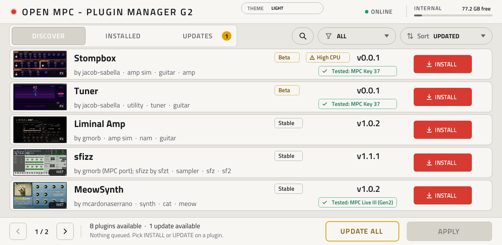
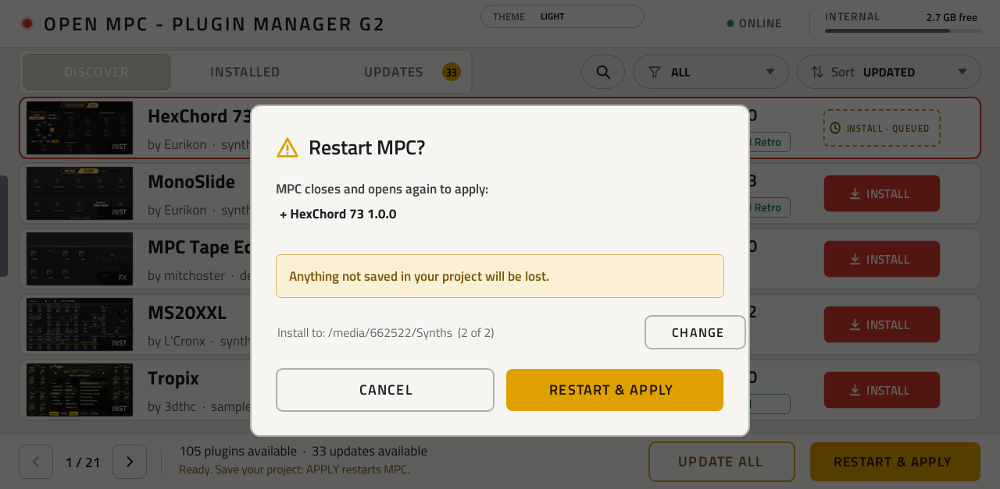

# OpenMPC Plugin Manager VST

> **Name.** The plugin is called the **OpenMPC Plugin Manager VST** (it used to be called "G2", which people took for a Gen2-only plugin: it runs on Gen1, Force and Gen2). Until its next release the name it shows on the device, its folder and its files still say "Plugin Manager G2" (`Plugin-Manager-G2-<version>-mpc-<armv7|aarch64>.zip`, catalog id `plugin-manager-g2`); those identifiers stay so installs and updates keep working.

Browse the OpenMPC plugin catalog and **install, update and remove plugins on the MPC itself**, from a plugin that runs inside MPC with its
own touchscreen skin. No computer, no USB stick and no SSH once it is installed. Built **Gen2 first** (MPC Live III and the other 64-bit
models, MPC OS 3.x), with a safety net: if an install fails, the plugin folder and `MPC.settings` are put back as they were and the screen says why.



## Built on poloq's work

**This manager exists because of [poloq](https://github.com/poloq-instruments)'s
[mpc-vst-manager](https://github.com/poloq-instruments/mpc-vst-manager).** poloq did the groundwork that matters most: the idea of a plugin
manager that lives *inside MPC as a plugin*, the whole working application (catalog browser, the download, checksum and install pipeline, the
detached restart that survives stopping MPC, the skin and layout generation, the baked card screenshots), and every release up to 1.2.0 (1.0.1,
1.1.0 and 1.2.0: the details page, search, filter and sort menus, the restart prompt). This project started as a fork of that code, at
`f01948b` (1.2.0, MIT), with poloq's git history kept; nearly everything you see on screen is poloq's design. What we added is described below.
See [Credits](#credits) for the full list and [NOTICE.md](NOTICE.md) for the licences.

## Why an official OpenMPC version

This is the **official OpenMPC plugin manager**. It draws on everything that came before it (poloq's manager above all, plus the ideas in
Eurikon's tool and the reports from people using it on real devices) and is maintained inside the OpenMPC project, so that it **stays aligned with
the project's development**: the catalog, its release rules and the official ways to install, update and remove plugins. It is built to support
**both Gen1 and Gen2** devices: one plugin, a 32-bit (armv7) build for Gen1 and a 64-bit (aarch64) build for Gen2, released together.

## What it does

**Browse**
- Reads the live catalog (`open-mpc.github.io/catalog.json`, falling back to the old `sd88me.github.io/mpc-vst-plugins/catalog.json`, which serves the same file) over the device's network: tabs **Discover**, **Installed** and
  **Updates** (with a count), a search box with an on-screen keyboard, a filter (All, Instruments, Effects, Addins) and a sort (Updated, Newest,
  Most downloaded, Name).
- Five plugins per page, each with a thumbnail, its version, a Stable or Beta badge, a *High CPU* warning when the catalog measured one, an *Old
  install* badge, and **Tested: <device>** when someone ran it on that hardware. Tap a card for its details page.
- Shows only what your device can install: each catalog version lists a zip per architecture, and the manager takes the one for your MPC (`aarch64` on Gen2, `armv7` on Gen1).

**Install, update, remove**
- **INSTALL**, **UPDATE** and **UPDATE ALL** queue changes (an update is offered only when the catalog has a newer version than yours; a newer build you installed by hand is left alone); **REINSTALL** and **REMOVE** are in the card's ⋮ menu. Nothing changes until you press
  **APPLY**, which shows what will happen and where, then restarts MPC once.
- Updates stay where the plugin already lives. New installs go to the first **usable** content location, internal storage first. When more than one
  is usable (the user drive and an SSD or card, say) the restart prompt shows where and has a **CHANGE** button; **the place you confirm is remembered**
  as the default for new installs (it is forgotten for a session only if that drive is not there, and returns when it is). The storage readout at the
  top right then names the drive (`CARD · 12.0 GB ▾`); tap it for an **INSTALL TO** menu of the usable places with their free space (0.2.5).
- Addins (the catalog's `addin` kind) are supported as well as plugins.

**Safe by design**
- Plugins go only to a folder MPC lists in `SynthContentLocations` (MPC draws a plugin's skin only from there). A location must be writable, not
  `noexec` and not a RAM disk; there is no silent fallback. When nothing qualifies, a red banner says so in plain words and `device.txt` lists every
  location with its reason.
- Before MPC is stopped, each package's SHA-256 is checked against the catalog, the zip is inspected (no absolute or `..` paths), and its manifest
  must match the device (architecture, glibc, MPC OS). A package that needs symbolic links is refused on a drive that cannot store them (exFAT).
- **Rollback:** every install, update or removal snapshots the plugin folder and `MPC.settings` first; on failure both are restored. After the
  restart the status line says, for example, *Last apply: 0 done, 1 failed and put back as they were. <name>: <reason>*.
- It keeps the newest 10 `MPC.settings.bak-*` backups, a small history file of what was installed or removed, and warns when MPC's image cache
  (a RAM disk) is nearly full, because a full cache makes parts of any skin draw black.

**Extras**
- **Light and dark theme** (the THEME pill; applied at the next restart, because MPC keeps skins in memory). Light is the default.
- **Local zips:** put a package zip in `local-plugins/` next to a content location's parent (for example `/nvme/local-plugins/`) and it appears as a
  card marked *by local zip*, with its own SHA-256 shown. Nothing vouches for it, so the usual checks still apply. Works with no network (0.2.3).
- **Register folders MPC does not list:** a plugin folder (with its `plugin-meta.xml`) copied by hand, or dropped from the list, appears in
  *Installed* with a **REGISTER** button that adds its entry to the plugin list.

## How to use it

**Install the manager** (once). Download `Plugin-Manager-G2-<version>-mpc-aarch64.zip` from the
[releases](https://github.com/open-mpc/mpc-vst-plugins/releases) (tag `plugin-manager-g2-v<version>`), unzip it, copy the folder to the device and run
the installer as root, naming your Synths folder (`INSTALL.md` in the zip explains how to find it: `/nvme/Synths` on a Live III,
`/storage/Synths` on an MPC One):

```sh
scp -r Plugin-Manager-G2-<version> root@<device-ip>:/tmp/
ssh root@<device-ip> sh /tmp/Plugin-Manager-G2-<version>/install.sh -t '<your Synths folder>'
```

Once it is listed in the catalog it should also install by id (`plugin-manager-g2`) from the installer app and `mpc-store.sh`; that has not been tried yet.

**Use it.**
1. Add **Plugin Manager G2** (VST, manufacturer *OpenMPC*) to an instrument track. The device needs a network connection for the catalog.
2. Browse or search; tap **INSTALL** on what you want (or **UPDATE**). Queue as many as you like.
3. Press **APPLY**, check the summary, and confirm. Save your project first: MPC restarts.
4. Reopen the manager. The status line reports the result; the new plugin is in the browser.

**Choose where plugins go.** When more than one place can take plugins (the user drive and an SSD or card, say), the restart prompt names the
folder the new ones will go to, with a **CHANGE** button that steps through the usable places. The place you confirm is remembered as the default
for new installs; updates always stay where the plugin already is. You can also pick it before you queue anything: tap the storage readout at the top right
(it shows the drive's name and a ▾ when there is a choice) and choose from **INSTALL TO**.



**Install a plugin by hand (a zip you downloaded).** For a plugin that is not in the catalog, or a beta you were sent:

1. **Get the right zip.** It must be the plugin's *package* zip, the file published for the plugin (on its catalog page or its GitHub release), not the
   "Source code" zip GitHub offers. A package carries an `install.sh` and an `mpc-plugin.json`, and is built for one CPU: `-mpc-armv7.zip` for a Gen1
   MPC or a Force, `-mpc-aarch64.zip` for a Gen2 (Live III, One G2, Key G2, XL). The manager refuses the wrong one. Keep the file name plain
   (letters, digits, `-`, `_`, `.`): a name with a quote, backslash, backtick or `$` in it is ignored, and so is one that starts with a dot.
2. **Put it in a `local-plugins` folder next to the parent of your Synths folder.** The parent is the drive your plugins live on:

   | Your Synths folder | Put the zip in |
   |---|---|
   | `/nvme/Synths` (Live III) | `/nvme/local-plugins/` |
   | `/sdcard/Synths` (Force, Gen1 MPC) | `/sdcard/local-plugins/` |
   | `/storage/Synths` (MPC One / Key on Gen2) | `/storage/local-plugins/` |
   | `/media/az01-internal/Synths` | `/media/az01-internal/local-plugins/` |

   Create the `local-plugins` folder if it is not there. With SSH: `ssh root@<device-ip> mkdir -p /nvme/local-plugins`, then
   `scp <the zip> root@<device-ip>:/nvme/local-plugins/`. Without SSH, use the USB plugin manager stick instead: it has its own `local-plugins` folder on
   the stick (the **Local** tab), which also works offline. The folders the manager looks in are the ones in `device.txt` (see below) under "usable".
3. **Open the manager** (add *Plugin Manager G2* to a track). **No network is needed** (from 0.2.3): if the catalog cannot be loaded, the manager says so in
   a small warning, and still lists the zips in `local-plugins`, what is installed and any folder to register. The list is read when the manager opens and on
   **REFRESH**; if you copied the zip while it was open, press **REFRESH** or close and reopen it. In 0.2.2 and earlier a local zip showed up only while
   the catalog loaded. The zip appears as a card marked **local zip**, newest first, named after the file; search for part of the file name if the list is long.
4. **Tap the card, then INSTALL, then APPLY.** Check the summary (it shows where the plugin will go; **CHANGE** steps through the usable places) and
   confirm. Save your project first: MPC restarts once, exactly as for a catalog plugin.

Nothing vouches for a local zip: the card shows the zip's own SHA-256 (the first 16 characters), so compare it with the checksum on the page you downloaded
it from. The other checks still apply: the zip is inspected (no absolute or `..` paths), its manifest must match your device (architecture, glibc, MPC OS),
a package that needs symbolic links is refused on exFAT, and a failed install is rolled back, with `MPC.settings` restored. If the card does not appear,
check the CPU in the zip's name, that the folder is next to a Synths folder listed as usable in `device.txt`, and the file name rules above.

**If something looks wrong**, the manager writes plain-text reports on the device: `/tmp/openmpc-pm/device.txt` (what it found: locations and why each
was accepted or refused, tools, glibc), `manager.log`, and `apply.log` (what the last apply did). Attach `device.txt` to a bug report.

## Requirements and limits

- A Gen1 (armv7: Force, MPC Live, One, X, Key) or Gen2 (aarch64: Live III and the other 64-bit models) MPC on MPC OS 3.x; the installer script needs root shell access once. One release carries both builds.
- Tested on an **MPC Live III (Gen2), MPC OS 3.10.0.49**, and a **Force (Gen1)**. The MPC One Gen2 layout (`/storage/Synths`) is covered by an offline test built from a user's
  own output, not yet run on a One.
- The device needs `systemd-run`, `unzip`, `sha256sum` and libcurl (all present on a stock Live III).
- MPC restarts on APPLY; MPC OS 3.10 has no autorun route (the basic one-prompt stick needs 3.9.1 or earlier), so the first install uses SSH or the installer app's plugin manager stick, which works on 3.10.
- A tap can reach the plugin twice on some screens; the manager ignores the same button twice within 250 ms.

## Building and testing

```sh
tools/plugin_manager_g2/vst/build_themes.sh aarch64        # plugin + light and dark skins into vst/build/
tools/plugin_manager_g2/tests/run.sh                      # the offline suite (about 9 minutes; needs Docker and network)
ONLY=safety tools/plugin_manager_g2/tests/run.sh          # one section: devices addins links pick theme safety arch
```

**Thumbnails** are baked into the skin when a release is built, so a plugin added to the catalog later shows its initials until the next release. A weekly
check (`.github/workflows/plugin-manager-g2-thumbs.yml`, `vst/thumbs_check.sh`) regenerates them from the live catalog and, when there are new ones,
pushes a branch and opens a pull request (or an issue with a compare link) for review; it never releases anything.

`DESIGN.md` has the design and the evidence behind it (what was seen on a device and what is only offline); `docs/NOTES.md` in the repo root has
the dated device findings. Releases are built by `.github/workflows/plugin-manager-g2.yml`.

## Credits

**poloq, the foundation.** [poloq-instruments/mpc-vst-manager](https://github.com/poloq-instruments/mpc-vst-manager) (MIT): the concept and the
whole original application, releases 1.0.1, 1.1.0 and 1.2.0, the card screenshots, the tested install flow on Gen1 hardware. Without it this
project would not exist. The upstream README and testing guide are kept in `docs/UPSTREAM_README.md` and `docs/UPSTREAM_TESTING.md`.

**jacob-sabella:** addin support for the manager (poloq PR #1: the catalog's `addin` kind, installed under `/data/mpc-addins/<id>` and removed with
its own `uninstall.sh`), the offline addin test fixture, the Key 37 test pass, and the Instruments-browser tile and default preset.

**Eurikon** ([plugin-manager-usb-for-open-mpc](https://github.com/Eurikon/plugin-manager-usb-for-open-mpc), MIT, Twisted Cable): ideas, not code.
Refusing to install without a listed content location, snapshot-and-restore around an apply, and a history file came from reading that tool.

**FullPace** (credited as *Padbangers*, poloq PRs #7 and #8): their reworked-screen work informed ours as ideas only. No code was copied, because the
PRs state no licence; any future copy waits for their yes.

**Bug reporters** whose issues on poloq's repo shaped the install-location rules: lionel-lints, camerondphillips, Potreba and djru5h; and the MPC
One user whose `mount` and settings output fixed the One's storage layout.

**Skin art:** the plugin thumbnails are screenshots supplied by each plugin's author in the catalog. Text in the skin is set in
[Titillium Web](https://fonts.google.com/specimen/Titillium+Web) (SIL Open Font License, shipped as `tools/html_art/fonts/OFL.txt`).

**OpenMPC / sd88me:** the Gen2 port (aarch64 build, install-location policy, per-architecture zips, rollback, theme, local zips, register,
history, tests), the OpenMPC look, and the catalog this reads.

"MPC" and "Akai" are trademarks of their owners; this project is not affiliated with Akai Professional. Nothing of Akai's firmware, skins or
images, and none of Steinberg's SDK, is in this repository.

## Licence

MIT (see [LICENSE](LICENSE); poloq's copyright notice is kept). Who wrote what, and what still needs permission, is in [NOTICE.md](NOTICE.md).
